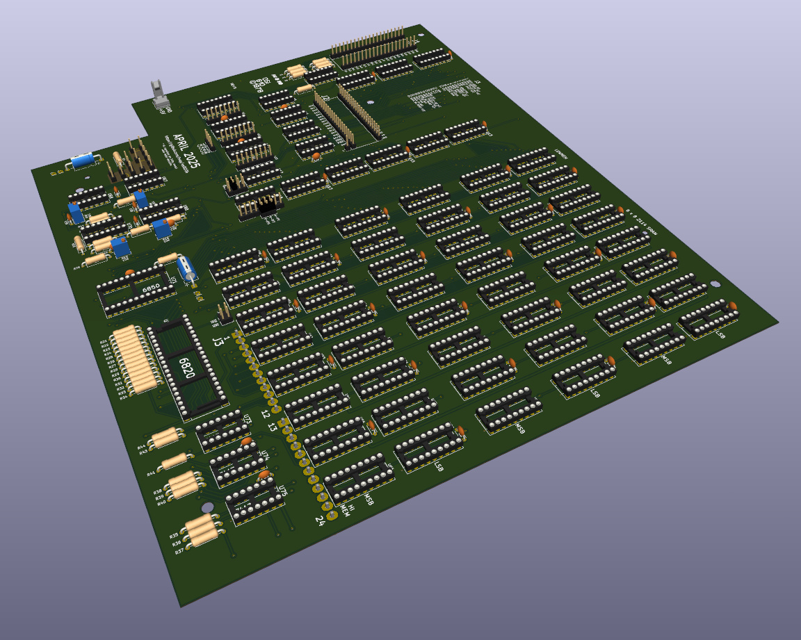

# Ohio Scientific 610B Remake

### Remake of the Ohio Scientific 610B Floppy Controller and Memory Expansion PCB

* The new [schematics](doc/osi610b-schematic.pdf) are based on the original schematics, but with all [errors](doc/errors.txt) fixed.
* The PCB is mostly identical to the original, but with added silkscreen, and jumpers instead of trace cuts.
* Except for drive type selection, which is kept original and does not have a solder mask to facilitate original adjustments.
* Use [ramtest2114](https://github.com/ivop/ramtest2114) to test RAM chips acquired from Ali.

Can be paired with the [Ohio Scientific 600D](https://github.com/ivop/osi600d) "CPU" board.
